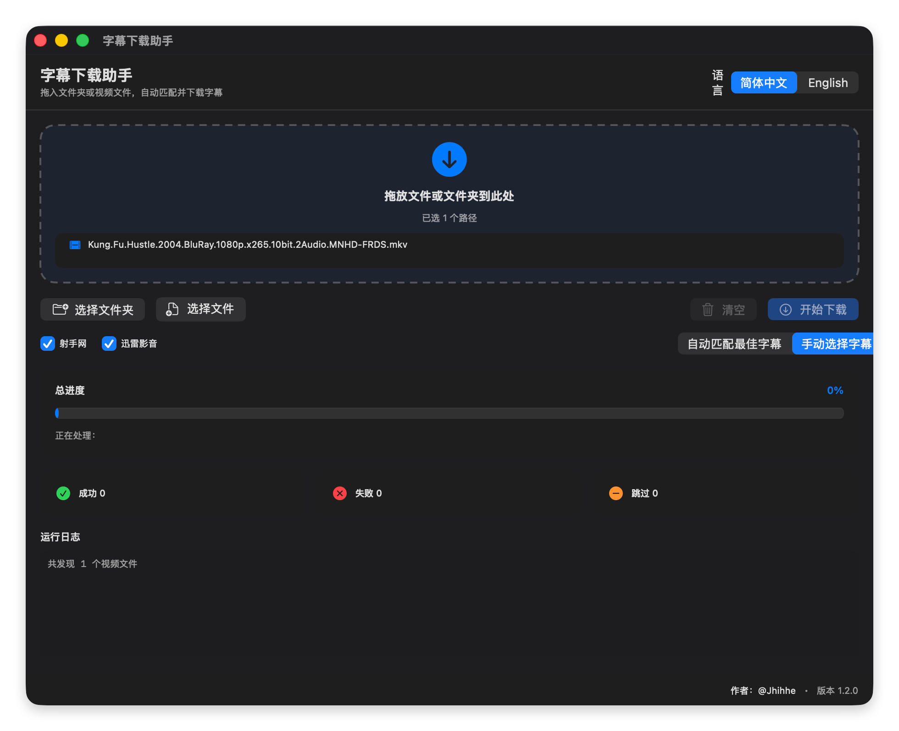
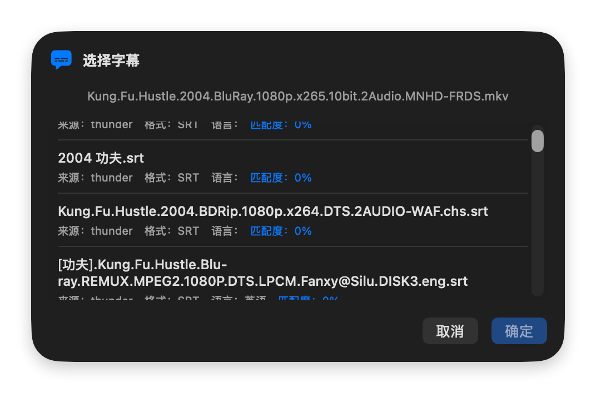

<div align="center">

# 🎬 字幕下载助手

一款基于 SwiftUI + Python 的 macOS 原生图形界面字幕下载工具。

[](https://swift.org)
[](https://python.org)
[](https://apple.com/macos)
[](./README.md)
[](./LICENSE)
[](https://github.com/jhihhe)

[中文](./README.md) · [English](./README_EN.md)

</div>

---

## ✨ 功能特性

- 🖱️ **拖放支持**：直接将文件或文件夹拖入窗口，支持多层文件夹递归扫描
- 📁 **批量选择**：支持同时选择多个文件或文件夹，拖放后实时显示已选名称
- 🔍 **双源匹配**：自动同时查询射手网（内容指纹）和迅雷影音（文件名 / CID）
- 🎛️ **源开关与手动选择**：可单独启用/禁用字幕源，并支持手动从多个候选字幕中挑选
- 📊 **图形化进度**：总进度条、实时状态文字、成功/失败/跳过统计卡片
- 📝 **详细日志**：每个视频的处理结果与运行日志实时展示
- 🌐 **中英文切换**：界面一键切换简体中文 / English
- 🎯 **智能去重**：已存在字幕自动跳过，支持覆盖模式
- 🎨 **原生应用图标**：采用现代 macOS 风格的专属应用图标

## 📸 界面预览





## 🚀 快速开始

### 环境要求

- macOS 13.0 或更高版本
- Xcode 命令行工具 / Swift 5.9+
- Python 3.9+

### 安装依赖

```bash
cd SubtitleDownloaderGUI
./setup.sh
```

### 构建与运行

```bash
# 调试运行
swift run --disable-sandbox SubtitleDownloaderGUI

# 打包为 .app
./package.sh
```

打包完成后会生成 `SubtitleDownloaderGUI.app`，双击即可运行。

> 注：未签名的 .app 首次运行可能被 Gatekeeper 拦截，请在 Finder 中右键选择“打开”。

## 🔧 代理设置

如果网络需要代理，可在启动前设置环境变量：

```bash
export SUBTITLE_PROXY=http://127.0.0.1:7890
```

## 📂 支持的视频格式

`mp4` `mkv` `avi` `mov` `wmv` `flv` `m4v` `ts` `strm`

## 🙏 鸣谢

本项目基于 [KiritoJia/SubtitleDownloadAssistant](https://github.com/KiritoJia/SubtitleDownloadAssistant) 的射手网和迅雷影音字幕源实现二次开发，感谢原作者的开源贡献。

## 👤 作者

**@Jhihhe**

- GitHub: [@jhihhe](https://github.com/jhihhe)
- 项目主页: [jhihhe/Subtitle-Download-Assistant-for-mac](https://github.com/jhihhe/Subtitle-Download-Assistant-for-mac)

## 📜 许可证

[MIT License](./LICENSE)
