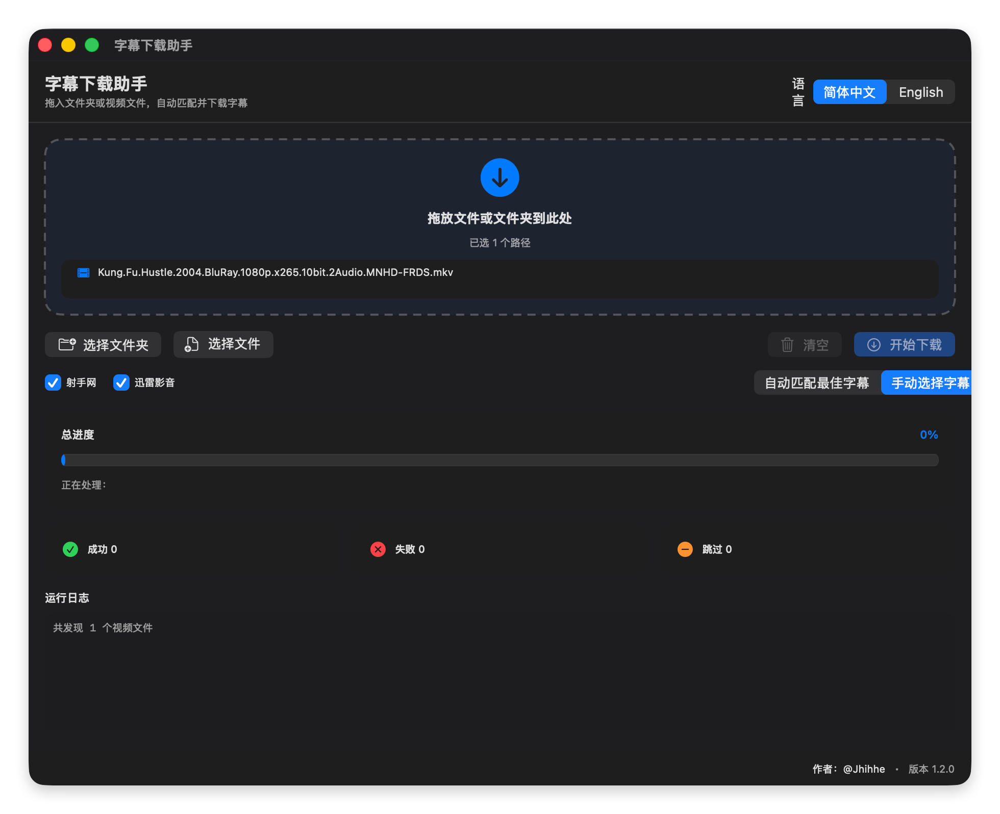
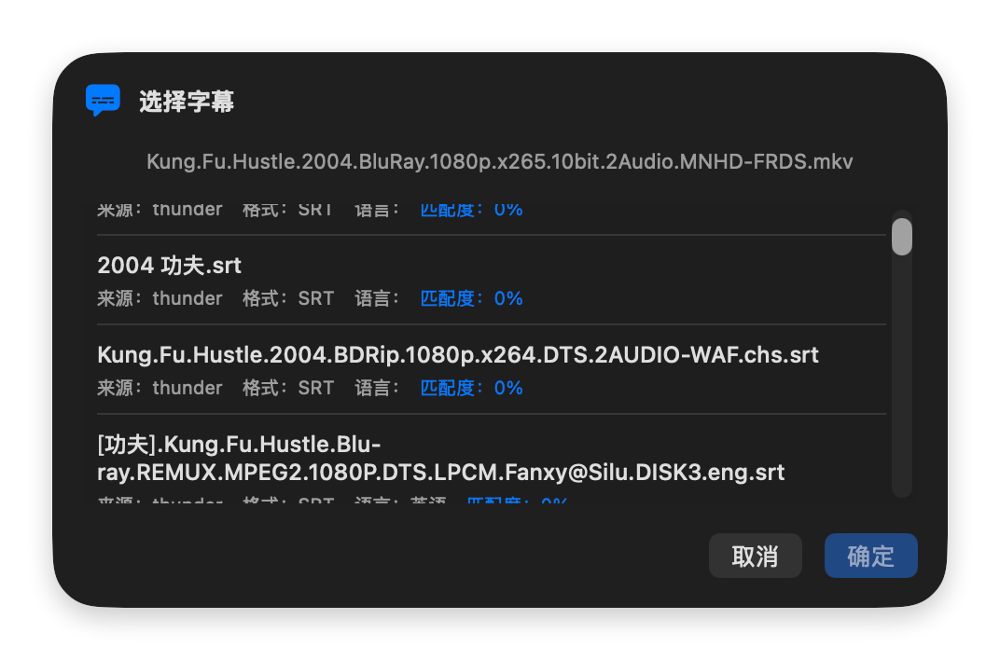

<div align="center">

# 🎬 Subtitle Download Assistant

A native macOS graphical subtitle downloader powered by SwiftUI + Python.

[](https://swift.org)
[](https://python.org)
[](https://apple.com/macos)
[](./README_EN.md)
[](./LICENSE)
[](https://github.com/jhihhe)

[中文](./README.md) · [English](./README_EN.md)

</div>

---

## ✨ Features

- 🖱️ **Drag & Drop**: Drop files or folders into the window; supports recursive scanning of multi-level folders
- 📁 **Batch Selection**: Select multiple files or folders at once; selected names are displayed in real time
- 🔍 **Dual-Source Matching**: Queries Shooter.cn (content fingerprint) and Thunder (filename / CID) simultaneously
- 🎛️ **Source Toggles & Manual Selection**: Enable or disable each subtitle source, and manually pick from multiple subtitle candidates
- 📊 **Graphical Progress**: Overall progress bar, live status text, success/failed/skipped stat cards
- 📝 **Detailed Logs**: Real-time processing results and runtime logs for every video
- 🌐 **Bilingual UI**: One-click switch between Simplified Chinese and English
- 🎯 **Smart Deduplication**: Auto-skip when subtitle already exists; overwrite mode supported
- 🎨 **Native App Icon**: Modern macOS-style custom app icon

## 📸 Preview

```text
┌─────────────────────────────────────────────────────────────┐
│  🎬 Subtitle Download Assistant        [简体中文][English]    │
├─────────────────────────────────────────────────────────────┤
│                                                             │
│              ⬇ Drop files or folders here                   │
│              3 path(s) selected (names shown)               │
│                                                             │
├─────────────────────────────────────────────────────────────┤
│  [Select Folder] [Select Files]  ☑Shooter ☑Thunder  Auto/Manual [Clear][Start] │
├─────────────────────────────────────────────────────────────┤
│  Overall Progress                                      67%  │
│  ████████████████████████████████░░░░░░░░░░░░░░░░░░░░░░░  │
│  Downloading: Movie Name (Shooter)                          │
├─────────────────────────────────────────────────────────────┤
│  ✅ Success 2    ❌ Failed 1    ⏭ Skipped 0                 │
├─────────────────────────────────────────────────────────────┤
│  Detailed Log                                               │
│  ✓ movie1.mkv  Saved movie1.srt (shooter)                   │
│  ✓ movie2.mkv  Saved movie2.srt (thunder)                   │
│  ✗ movie3.mkv  No subtitle candidates found                 │
└─────────────────────────────────────────────────────────────┘
```

### Screenshots





## 🚀 Quick Start

### Requirements

- macOS 13.0 or later
- Xcode Command Line Tools / Swift 5.9+
- Python 3.9+

### Install Dependencies

```bash
cd SubtitleDownloaderGUI
./setup.sh
```

### Build & Run

```bash
# Debug run
swift run --disable-sandbox SubtitleDownloaderGUI

# Package as .app
./package.sh
```

After packaging, `SubtitleDownloaderGUI.app` will be generated. Double-click to run.

> Note: Unsigned `.app` bundles may be blocked by Gatekeeper on first launch. Right-click and select "Open" in Finder.

## 🔧 Proxy

If your network requires a proxy, set the environment variable before launching:

```bash
export SUBTITLE_PROXY=http://127.0.0.1:7890
```

## 📂 Supported Video Formats

`mp4` `mkv` `avi` `mov` `wmv` `flv` `m4v` `ts` `strm`

## 🙏 Credits

This project is built upon the Shooter.cn and Thunder subtitle sources from [KiritoJia/SubtitleDownloadAssistant](https://github.com/KiritoJia/SubtitleDownloadAssistant). Thanks to the original author for the open-source contribution.

## 👤 Author

**@Jhihhe**

- GitHub: [@jhihhe](https://github.com/jhihhe)
- Project Home: [jhihhe/Subtitle-Download-Assistant-for-mac](https://github.com/jhihhe/Subtitle-Download-Assistant-for-mac)

## 📜 License

[MIT License](./LICENSE)
